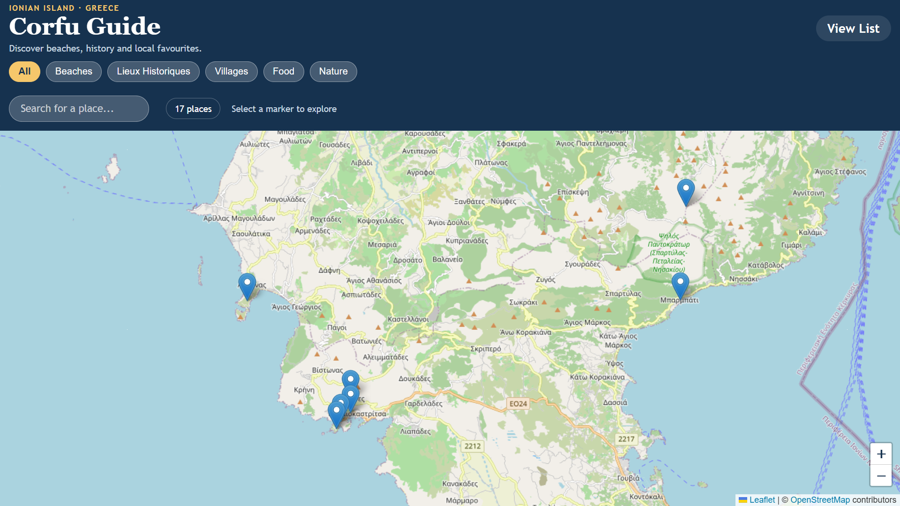

# Corfu Guide

A self-guided, map-based guide to Corfu, Greece. Explore beaches, historic sites, villages, food spots and nature areas on an interactive map, or browse them in a list.

**Live demo:** https://yanisbleu.github.io/Kerkyra/



## Features

- Interactive map centred on Corfu, built with Leaflet and OpenStreetMap
- One marker per place, with a popup showing its name and description
- Category filters: All, Beaches, Historic Sites, Villages, Food, Nature
- A live counter showing how many places are currently displayed
- A separate list view ([liste.html](liste.html)) with the same places
- Responsive layout for mobile and desktop

## Tech stack

- HTML5, CSS3 and vanilla JavaScript (ES6+)
- [Leaflet](https://leafletjs.com/) 1.9.4 for the interactive map
- [OpenStreetMap](https://www.openstreetmap.org/) tiles for the map background
- No framework, no build step and no backend

## Project structure

```
Kerkyra/
├── index.html    # map page with filters and counter
├── liste.html    # list view of places
├── style.css     # layout and styling
├── places.js     # place data (name, category, coordinates, description)
├── app.js        # map, markers, popups and filtering logic
└── README.md     # this file
```


## Adding a place

All places are stored in `places.js`. Add an object to the array:

```js
{
  name: "Benitses Beach",
  category: "beach",        // beach, history, village, food or nature
  lat: 39.5167,
  lng: 19.9333,
  description: "Sandy beach a few steps from the village."
}
```

## Running locally

Clone the repository and open `index.html` in a browser, or serve the folder with a local server:

```bash
python -m http.server 8000
```

Then visit `http://localhost:8000`.

## Data accuracy

Coordinates and descriptions were checked on public maps but are approximate. They are intended for a demonstration project, not for navigation.

## What I learned

Building this project taught me how to use OpenStreetMap correctly through Leaflet. I learned that map tiles must be loaded from a valid source and that OpenStreetMap requires its attribution to be displayed. I also learned to pay attention to the order of coordinates (latitude first, then longitude), since reversing them puts markers in the wrong place. Keeping the place data in a separate file made it easy to add or change places without touching the map logic.

## Possible improvements

- Route planning between places
- Search by place name
- Translations into French and Greek
- Offline support

## Author

**Yanis.B**: second-year BUT Computer Science student.
GitHub: [YanisBleu](https://github.com/YanisBleu) · Portfolio: [yanisbleu.github.io](https://yanisbleu.github.io)

## License

This project is licensed under the MIT License. See the [LICENSE](LICENSE) file for details.
